# Heart Disease Risk Prediction — End-to-End MLOps Pipeline

**Course:** AIMLCZG523 — Machine Learning Operations (MLOps)
**Assignment:** 01 — End-to-End ML Model Development, CI/CD, and Production Deployment
**Author:** Shashank Pandey
**BITS ID:** 2025AE05689
**Repository:** https://github.com/shashankp1502/mlops

---

## 1. Introduction

This report documents a reproducible, production-style pipeline for a
binary classifier that predicts heart disease risk from patient health
data — covering data acquisition, EDA, feature engineering, model
training with experiment tracking, automated testing, CI/CD,
containerization, Kubernetes deployment, and monitoring.

Everything described below was actually run during development (not
just written down): the dataset was downloaded live from UCI, both
models were trained and logged to MLflow, the full pytest suite was
executed, the Docker image was built and smoke-tested locally, and the
whole stack was deployed to a local Minikube cluster with Prometheus and
Grafana scraping real traffic — screenshots and CLI output for each stage
are in `screenshots/`.

---

## 2. System Architecture

The diagram below summarizes the full flow, from the UCI data source
through EDA, training + MLflow tracking, model packaging, the FastAPI
serving layer, Docker containerization, and the Minikube deployment with
Prometheus/Grafana monitoring:

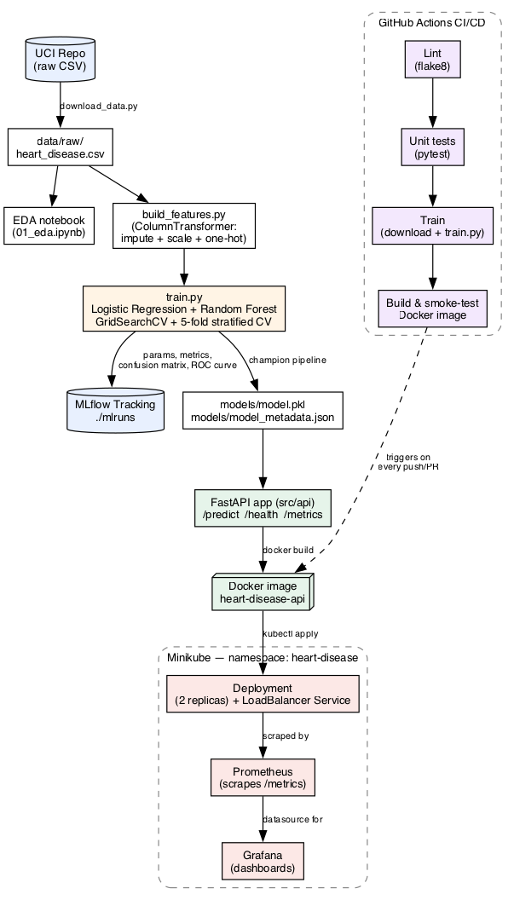

The authoritative, version-controlled source for this diagram is a
Mermaid flowchart in `README.md` (renders natively in GitHub's web UI) —
the PNG above is a matching static rendering for this Word/PDF report.

The rest of this report walks through each stage of that diagram in
order: data and EDA, feature engineering, modelling, experiment
tracking, packaging, testing, CI/CD, containerization, deployment, and
monitoring — followed by a practical "Getting Started" reference at the
end.

---

## 3. Dataset & Exploratory Data Analysis

**Dataset:** UCI Cleveland Heart Disease dataset (`processed.cleveland.data`)
— 303 patients, 13 features (age, sex, chest pain type, resting blood
pressure, cholesterol, fasting blood sugar, resting ECG, max heart rate,
exercise-induced angina, ST depression, slope, number of major vessels,
thalassemia type), binary target derived by collapsing the original 0-4
severity label into "disease present / absent".

Downloaded via `src/data/download_data.py` directly from the UCI archive
— no manual download step, and no dataset file is committed to git (only
a `.gitkeep` placeholder); the script re-fetches it in ~2 seconds and
fails loudly with a clear message if the source is unreachable.

**Data quality:** only 6 of 303 rows (2%) have missing values, confined
to `ca` and `thal`. Not dropped — handled with median/mode imputation
inside the feature pipeline (fit only on the training fold).

**Key EDA findings** (full notebook: `notebooks/01_eda.ipynb`,
figures: `docs/figures/`):

- **Class balance:** 54% no-disease / 46% disease — close enough to
  balanced that no resampling (SMOTE etc.) was used; stratified splits
  were used anyway given the small sample size (303 rows total).
- **`thalach` (max heart rate)** is noticeably lower in the disease group;
  **`oldpeak`** (ST depression) is noticeably higher — both consistent
  with reduced exercise tolerance in diseased hearts.
- **`cp` (chest pain type)`, `thal`, and `exang`** show the cleanest
  separation between classes among the categorical features.
- **No problematic multicollinearity** between predictors (correlation
  matrix, `docs/figures/correlation_heatmap.png`) — nothing dropped for
  redundancy.
- `chol` and `trestbps` are right-skewed with a handful of high outliers,
  which is expected for real clinical measurements (not treated as
  errors — handled via scaling rather than removal).

| Figure | Shows |
|---|---|
| `target_balance.png` | 54/46 class split |
| `numeric_histograms.png` | Distributions of age, trestbps, chol, thalach, oldpeak |
| `numeric_vs_target.png` | age/thalach/oldpeak boxplots split by target |
| `categorical_vs_target.png` | cp, sex, exang, slope, thal, restecg vs target |
| `correlation_heatmap.png` | Full feature correlation matrix |

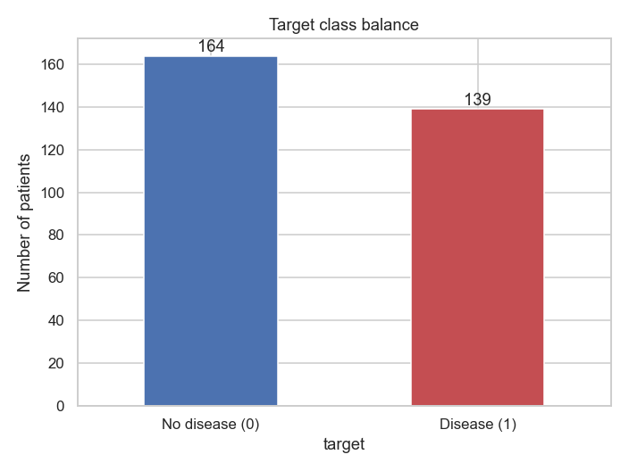

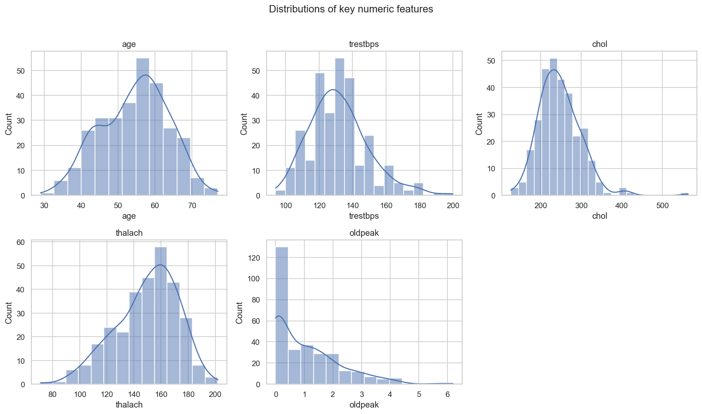

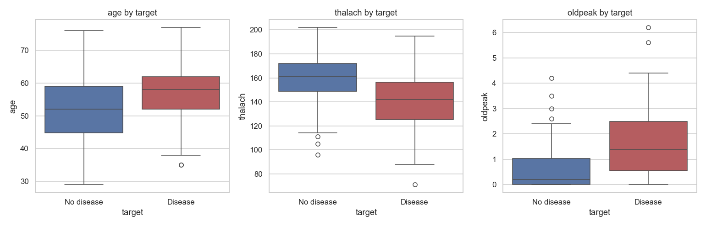

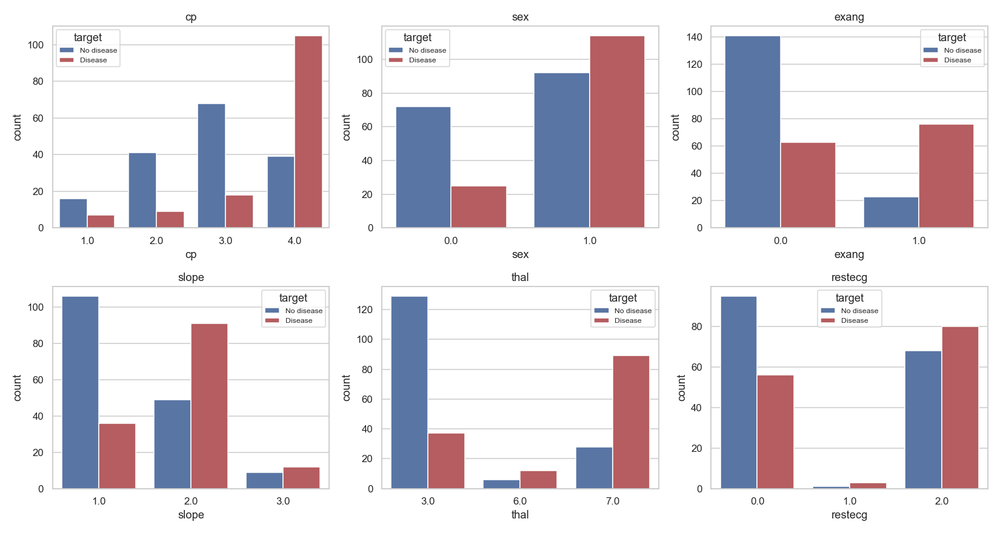

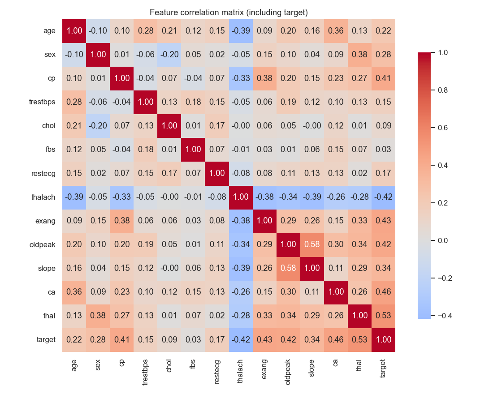

---

## 4. Feature Engineering

Implemented as a single `sklearn.compose.ColumnTransformer`
(`src/features/build_features.py`) so the exact transformation used during
training is serialized with the model and reused unchanged at inference
time — no risk of training/serving skew from re-implementing cleaning
logic in the API layer.

| Feature group | Columns | Transform |
|---|---|---|
| Numeric / ordinal | age, trestbps, chol, thalach, oldpeak, ca | median impute -> standard scale |
| Nominal categorical | cp, restecg, slope, thal | most-frequent impute -> one-hot encode |
| Already binary | sex, fbs, exang | most-frequent impute (guards future missing values) |

---

## 5. Model Development & Results

**Models trained** (`src/models/train.py`): **Logistic Regression** and
**Random Forest**, each tuned via `GridSearchCV` with 5-fold **stratified**
cross-validation, scored on ROC-AUC:

- Logistic Regression grid: `C ∈ {0.01, 0.1, 1, 10}`, `penalty ∈ {l1, l2}`,
  `class_weight ∈ {None, balanced}` (solver=`liblinear` to support both penalties)
- Random Forest grid: `n_estimators ∈ {100, 300}`, `max_depth ∈ {None, 5, 10}`,
  `min_samples_leaf ∈ {1, 2, 4}`

### Results

| Model | CV ROC-AUC (mean, 5-fold) | Test Accuracy | Test Precision | Test Recall | Test F1 | Test ROC-AUC |
|---|---|---|---|---|---|---|
| **Logistic Regression (champion)** | 0.9071 | 0.8852 | 0.8182 | **0.9643** | 0.8852 | **0.9589** |
| Random Forest | 0.8985 | 0.8852 | **0.8387** | 0.9286 | 0.8814 | 0.9535 |

Best Logistic Regression hyperparameters: `C=1`, `penalty=l2`,
`class_weight=balanced`.
Best Random Forest hyperparameters: `n_estimators=300`, `max_depth=5`,
`min_samples_leaf=4`.

**Why Logistic Regression won:** both models perform similarly overall,
but Logistic Regression edges out on held-out ROC-AUC and recall — for a
disease-screening use case, missing fewer actual positive cases (higher
recall) is arguably more important than Random Forest's slightly better
precision. The simpler, more interpretable model winning on a clean,
well-behaved, moderately-sized tabular dataset (303 rows, mild class
imbalance, no strong non-linear interactions visible in EDA) also tracks
with what's generally expected — Random Forest's extra flexibility isn't
needed here and mostly adds variance on a small test set (61 rows).

Confusion matrices and ROC curves for both runs:

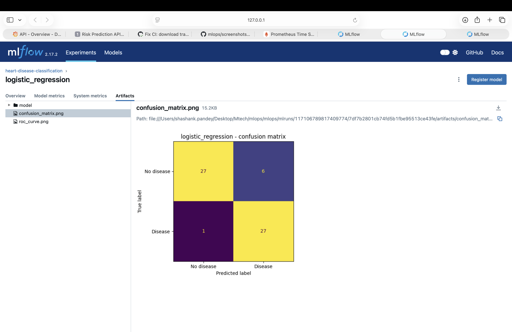

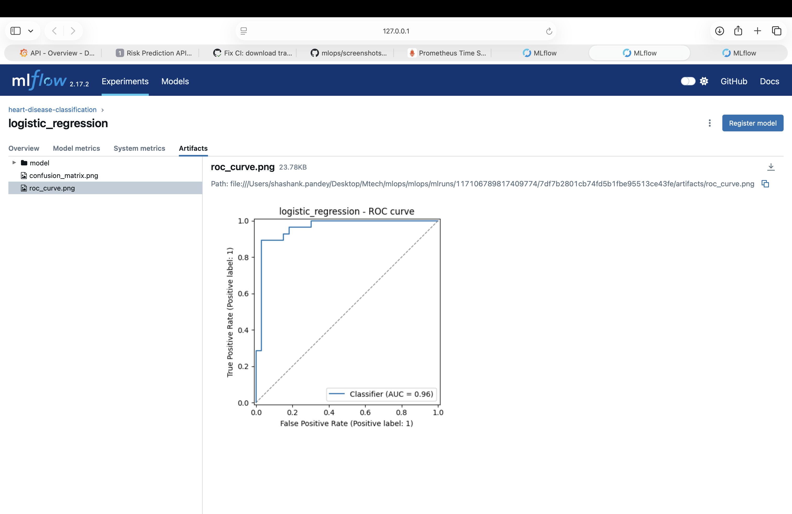

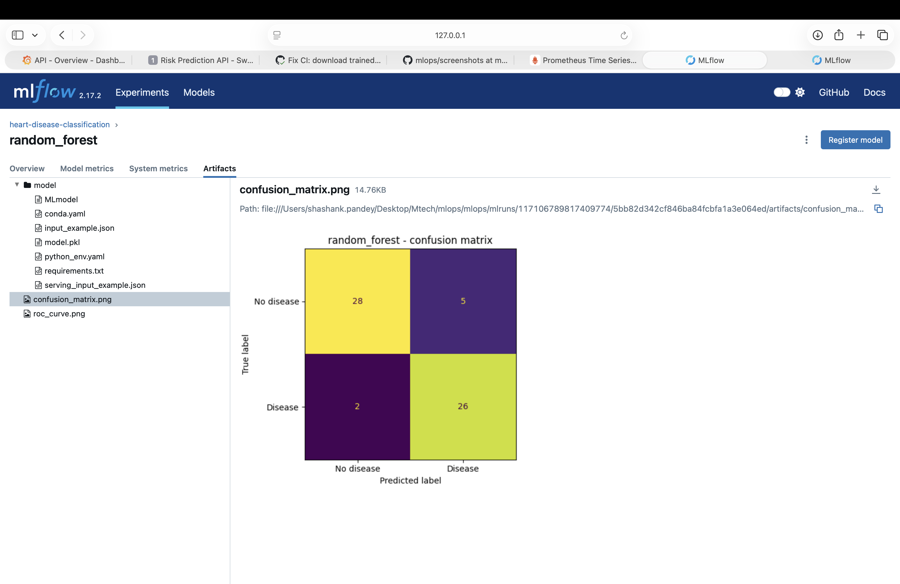

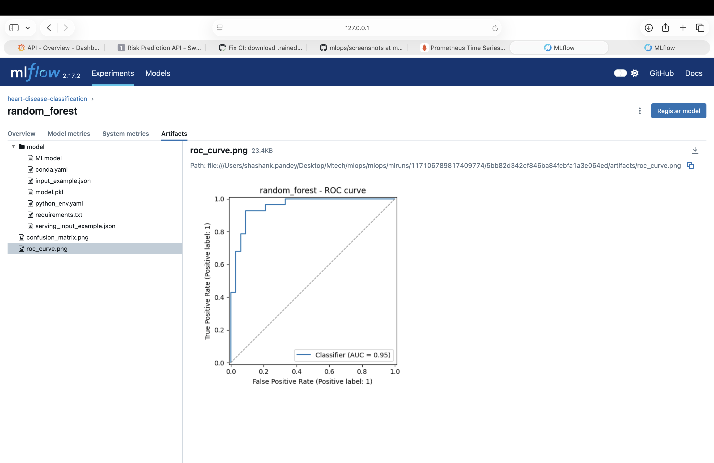

---

## 6. Experiment Tracking (MLflow)

Every GridSearchCV run is logged as its own MLflow run under the
`heart-disease-classification` experiment, with:

- **Params:** winning hyperparameters from the grid search, CV fold count
- **Metrics:** CV ROC-AUC mean, and test accuracy/precision/recall/F1/ROC-AUC
- **Artifacts:** confusion matrix PNG, ROC curve PNG, the full serialized
  pipeline (via `mlflow.sklearn.log_model`, including an inferred input
  signature)
- **Tags:** `model_family`, plus a `champion=true` tag set retroactively on
  whichever run wins, so the winner is identifiable straight from the
  MLflow UI without cross-referencing JSON files

Tracking store: local file-based (`file:./mlruns`), kept out of git
(regenerable by re-running `train.py`).

Side-by-side run comparison from the MLflow UI (`logistic_regression`
vs. `random_forest`, matching the results table above exactly):

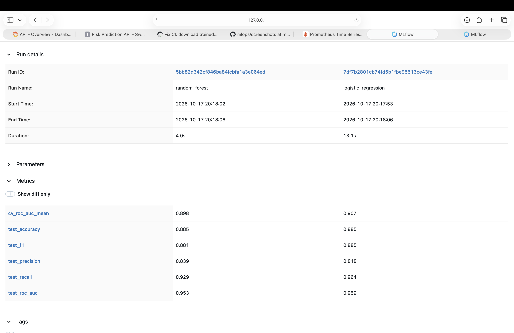

---

## 7. Model Packaging & Reproducibility

- The **champion's full pipeline** (preprocessing `ColumnTransformer` +
  fitted classifier) is pickled as a single artifact: `models/model.pkl`
  via `joblib.dump`. Loading one file is enough to reproduce
  training-time preprocessing exactly — the API never re-implements
  imputation/scaling/encoding logic separately.
- `models/model_metadata.json` records the champion's name, training
  timestamp, best hyperparameters, test metrics, the exact feature column
  order expected, and a summary of *all* candidates trained (not just the
  winner) — useful for audit/debugging later.
- Two requirements files, deliberately split:
  - `requirements-api.txt` — the minimal runtime set (pandas, scikit-learn,
    FastAPI, uvicorn, prometheus-client, ...) baked into the Docker image.
  - `requirements.txt` — the full dev superset (adds MLflow, matplotlib/
    seaborn, pytest, flake8, jupyter) for local development/training.
    All packages are version-pinned for reproducibility.

---

## 8. Automated Testing

**Unit tests** (`tests/`, 40 tests, pytest): cover data parsing
(`download_data.parse_cleveland`), preprocessing (`split_features_target`,
stratified splitting), the feature pipeline (no-NaN output, correct
one-hot expansion, independent refits), evaluation metric computation
(including edge cases like single-class predictions), model
packaging/inference (`HeartDiseaseModel`), the training pipeline's
structural correctness, and the FastAPI layer (valid/invalid payloads,
response schema, Prometheus metrics exposure). Deliberately **no test
depends on the network or on `models/model.pkl` already existing** — a
small synthetic fixture dataset (`tests/conftest.py`) stands in for the
real data, so the suite runs identically on a clean checkout before any
training has happened.

---

## 9. CI/CD Pipeline

`.github/workflows/ci.yml` runs four sequential jobs, each gated on the
previous one succeeding:

1. **lint** — `flake8 src tests`
2. **test** — `pytest` with coverage, JUnit + coverage XML uploaded as artifacts
3. **train** — downloads the dataset fresh, runs `src.models.train`,
   asserts `model_metadata.json` was produced, uploads the trained
   model + full MLflow run directory as artifacts
4. **docker** — downloads the model artifact from the `train` job, builds
   the Docker image, runs the container, polls `/health` until ready,
   sends a real `/predict` request and asserts the response shape, then
   uploads the container logs and response JSON as artifacts

Any failure (lint error, failing test, training crash, or a container
that never becomes healthy / returns a bad response) **fails the whole
pipeline with a non-zero exit code and a readable log**, satisfying the
"must fail on error with clear logs" production-readiness requirement.

All 4 jobs passing on a live run (`main` branch):

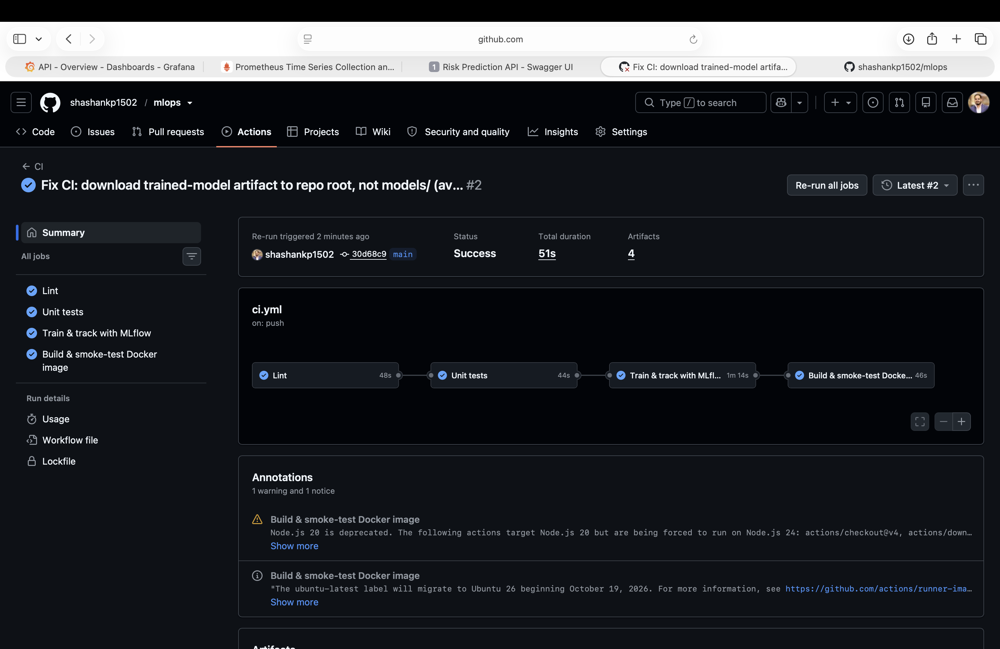

The `train` job's own logs, downloading the dataset fresh and showing
both models' metrics (matches the results table in Section 5 exactly):

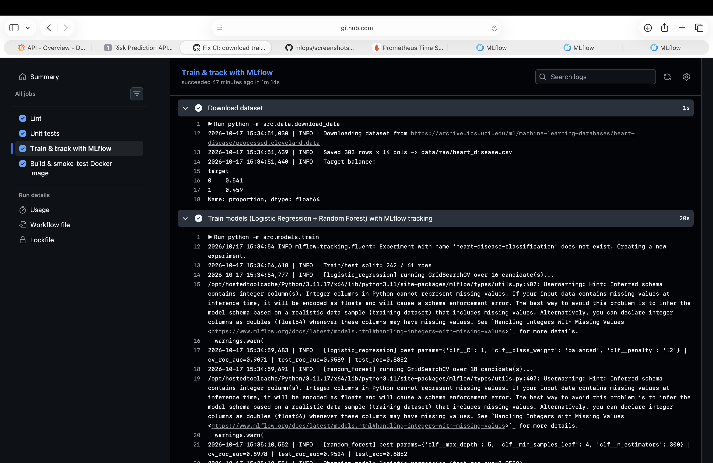

---

## 10. Containerization

`docker/Dockerfile` — multi-stage build:
- **Stage 1 (builder):** installs `requirements-api.txt` into a venv
  (needs `build-essential` for a couple of wheels)
- **Stage 2 (runtime):** `python:3.11-slim` + the venv copied over, app
  code, and the two model artifacts — no compiler toolchain in the final
  image. Runs as a non-root user, exposes port 8000, includes a
  `HEALTHCHECK` hitting `/health`.

Final image size: **~550-770MB** (varies slightly by host vs. Minikube's
docker daemon layer caching) — down from ~1.17GB with a naive single-stage
build.

**Verified locally**:
```bash
docker build -t heart-disease-api:latest -f docker/Dockerfile .
docker run -d --name heart-disease-api -p 8000:8000 heart-disease-api:latest
curl http://localhost:8000/health
# {"status":"ok","model_loaded":true,"champion_model":"logistic_regression"}
curl -X POST http://localhost:8000/predict -d '{...}'
# {"prediction":0,"label":"no_disease","confidence":0.7764,...}
```

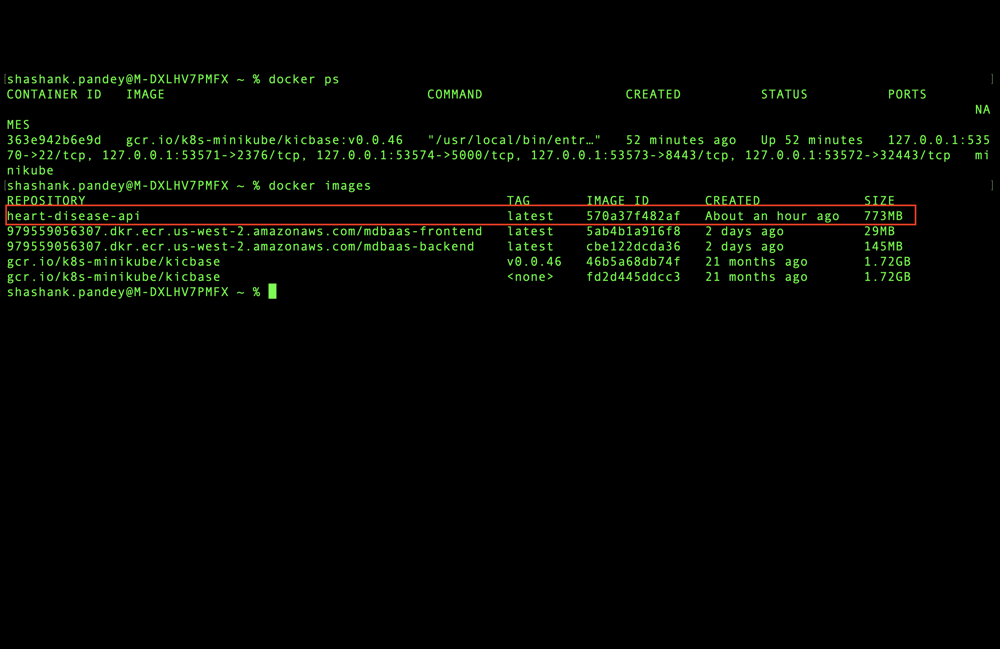

The FastAPI interactive docs (Swagger UI) generated automatically from
the Pydantic schemas in `src/api/schemas.py`:

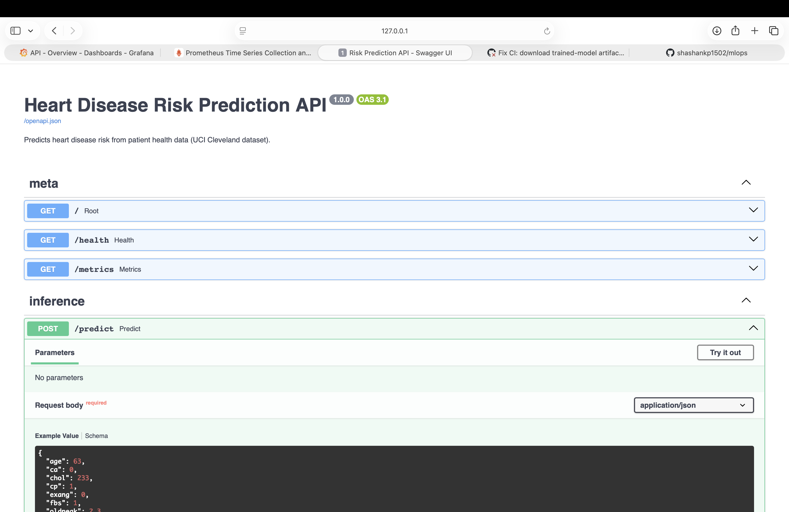

---

## 11. Kubernetes Deployment

Deployed to a local Minikube cluster (namespace `heart-disease`):

- **`k8s/deployment.yaml`** — 2 replicas, resource requests/limits
  (100m/256Mi -> 500m/512Mi), readiness probe (`/health`, 5s initial delay)
  and liveness probe (`/health`, 15s initial delay) so Kubernetes only
  routes traffic to pods that have actually finished loading the model
- **`k8s/service.yaml`** — `LoadBalancer` type, port 80 -> containerPort 8000
  (exposed locally via `minikube tunnel` / `minikube service --url`)

**Verified end-to-end**:

```
$ kubectl -n heart-disease get deploy
NAME                READY   UP-TO-DATE   AVAILABLE   AGE
heart-disease-api   2/2     2            2           80s

$ curl http://<minikube-service-url>/health
{"status":"ok","model_loaded":true,"champion_model":"logistic_regression"}

$ curl -X POST http://<minikube-service-url>/predict -d '{...}'
{"prediction":0,"label":"no_disease","confidence":0.7764,"probability_disease":0.2236,"model_version":"model.pkl"}
```

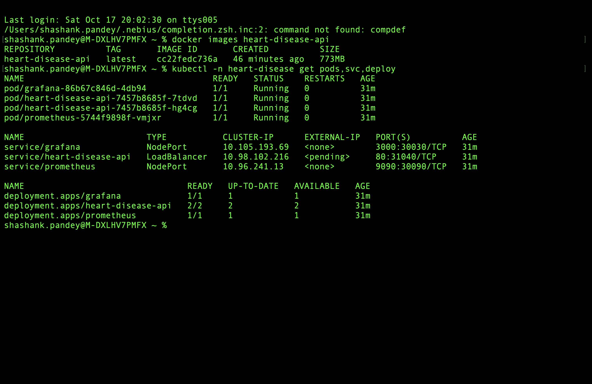

Both replicas came up healthy and served real predictions through the
LoadBalancer service, not just the pod's own loopback.

---

## 12. Monitoring & Observability

**Request logging:** every API request is logged as a single structured
line (request id, method, path, status code, latency in ms) via a FastAPI
middleware (`src/api/main.py`) — written to stdout so it's captured by
Docker/`kubectl logs` without any extra agent.

**Metrics:** `prometheus_client` instrumentation exposes `/metrics` with:
- `api_requests_total{endpoint,method,status_code}` — request counts
- `model_predictions_total{label}` — prediction outcome counts
- `api_request_latency_seconds{endpoint}` — latency histogram

**Deployed stack** (`k8s/monitoring/`):
- **Prometheus** (`prom/prometheus:v2.54.1`) scrapes the
  `heart-disease-api` Kubernetes Service directly every 10s (static
  target, no operator/CRDs needed for this scale)
- **Grafana** (`grafana/grafana:11.2.0`) auto-provisions the Prometheus
  datasource and a ready-made **"Heart Disease API - Overview"** dashboard
  (request rate by endpoint, predictions by label, p95 latency, HTTP
  status codes) via ConfigMaps — zero manual dashboard-building

Both were verified live against real traffic generated by scripted
`/predict` calls against the Minikube deployment:

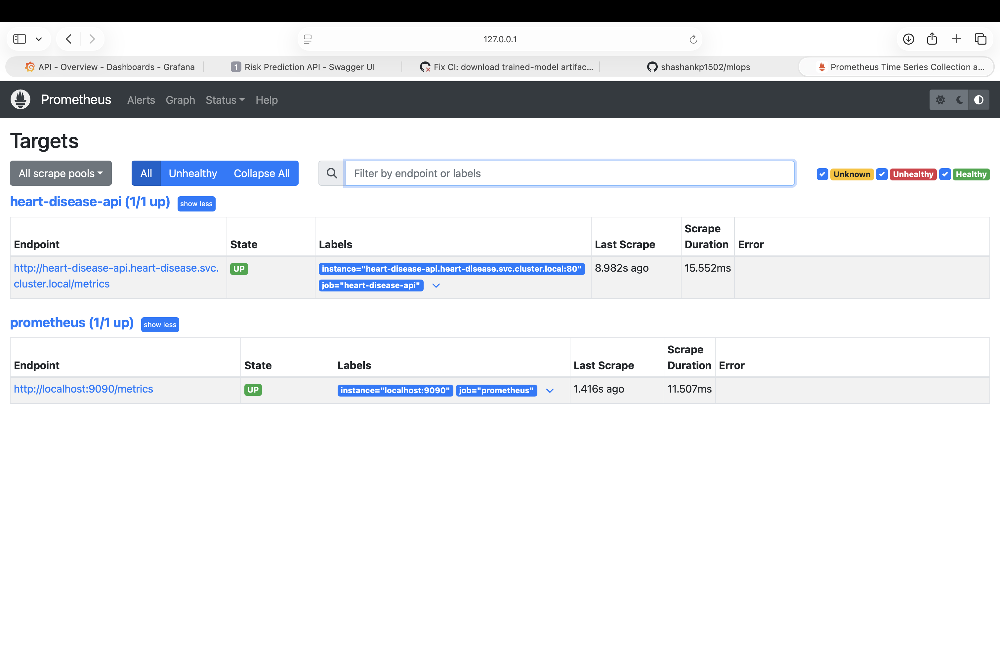

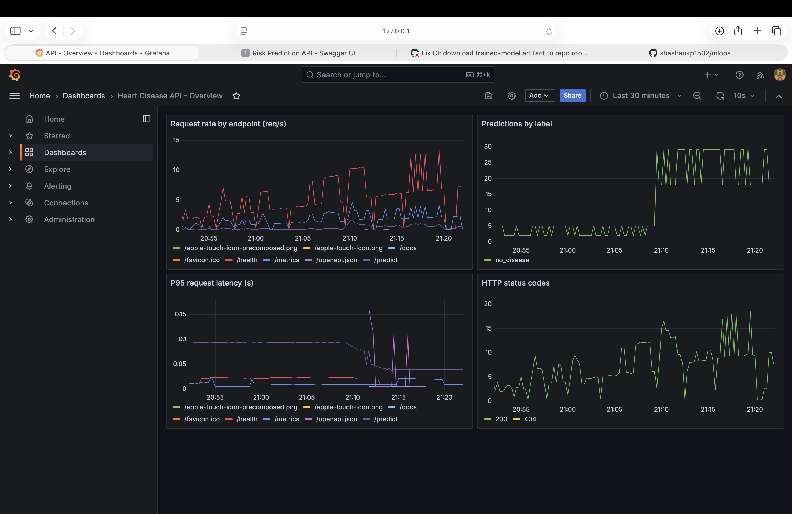

---

## 13. Getting Started (Setup & Usage Reference)

```bash
git clone https://github.com/shashankp1502/mlops.git
cd mlops

python3.11 -m venv .venv
source .venv/bin/activate
pip install -r requirements.txt

python -m src.data.download_data      # fetches data/raw/heart_disease.csv from UCI
python -m src.models.train            # trains + logs to MLflow, saves models/model.pkl
pytest                                 # 40+ tests, ~1s
uvicorn src.api.main:app --reload      # API on http://localhost:8000
```

Full step-by-step instructions for Docker, Kubernetes, and monitoring are
in the project `README.md`; they're not repeated verbatim here to keep
this report focused on *decisions and results* rather than command
transcripts.

---

## 14. Repository Link

https://github.com/shashankp1502/mlops
